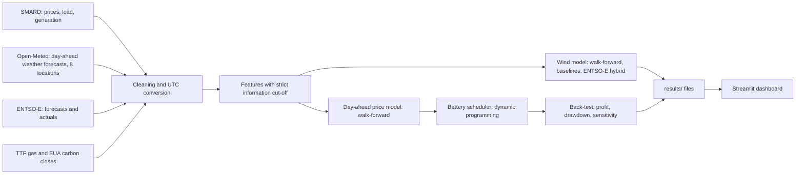

# European Power Market Analytics

Day-ahead forecasting of German wind generation, a day-ahead price model, and a back-test of a virtual battery,
built to mirror work on an energy trading desk.

**Live dashboard:** https://powermarketanalytics-vkfkcqzzrlx3kammfanaqj.streamlit.app/

## Headline results

All numbers are from a final test period (April to September 2026) that was never used for tuning.
Models are evaluated with walk-forward validation: each month is predicted by a model trained only on earlier data.

**Wind generation, day-ahead (4,392 test hours)**

| Model | MAE (MW) | RMSE (MW) | MAE vs ENTSO-E |
|---|---|---|---|
| ENTSO-E day-ahead forecast (benchmark) | 1,387 | 2,194 | - |
| Hybrid: ENTSO-E forecast + learned correction | 1,323 | 2,025 | -4.6% |
| Weather-based model (8 locations) | 2,182 | 3,070 | +57% |
| Simple power curve | 2,754 | 3,953 | +99% |
| Persistence (2 days ago) | 8,781 | 11,381 | +533% |

The hybrid model's MAE is lower than ENTSO-E's on 55% of days; the 95% bootstrap interval for the difference is
-117 to -19 MW. The weather-based model alone does **not** beat ENTSO-E.

**Virtual battery (1 MW / 2 MWh) in the day-ahead market, test period, 181 days**

| Strategy | Total profit | Share of perfect foresight |
|---|---|---|
| Perfect foresight (upper limit) | EUR 54,859 | 100% |
| Model | EUR 53,934 (EUR 298/day) | 98% |
| Naive: yesterday's prices | EUR 51,809 | 94% |
| Naive: last week's prices | EUR 50,851 | 93% |

The model earns about EUR 12 per day more than the "yesterday" baseline (95% interval EUR 6 to 19). Hourly price error is
21 EUR/MWh versus 33 for the best naive baseline. Assumptions: 88% round-trip efficiency, 2 EUR/MWh on every MWh traded,
one full cycle per day, price taker. Results across efficiency 80-92% and costs 0-4 EUR/MWh are in `results/backtest_sensitivity.csv`.

## Architecture

## Method

- **No look-ahead.** A forecast for day D is made before the day-ahead auction closes (12:00 CET on D-1). Features built
  from actual generation or prices stop before that cut-off; gas and carbon use the close dated D-2 or earlier. Automated
  tests (`tests/`) scramble future data and check that no feature changes, including on 23- and 25-hour clock-change days.
- **Walk-forward validation.** Each month is predicted by a model retrained on all earlier data, with a 2-day gap.
  Settings were chosen on April 2025 to March 2026 only (`results/dev_experiments.csv`, `results/backtest_dev.csv`).
- **Benchmark.** ENTSO-E's own published day-ahead wind forecast, evaluated against ENTSO-E actual generation.
- **Reproducible.** Re-running the scripts from a clean folder gives identical results.

## Run it

1. `pip install -r requirements.txt`
2. Put raw files in `data/raw/` (not included): `entsoe/`, `weather/`, `smard/`, `fuels/` (see `src/pmp/data.py`).
3. `python tests/test_no_leakage.py`, `python tests/test_battery.py`, `python tests/test_price_no_leakage.py`, `python tests/test_agent.py`
4. `python scripts/01_dev_experiments.py`, `python scripts/02_final_evaluation.py` (wind model)
5. `python scripts/03_price_model.py`, `python scripts/04_backtest.py` (price model and battery back-test)
6. `python scripts/05_business_impact.py` (illustrative euro value of forecast errors); `Rscript r/analysis.R` (R version of the test-period analysis)
7. `streamlit run app.py` (needs only the files in `results/`)

## Documentation
`docs/METHODOLOGY.md` explains the data, validation design, models, results and likely interview questions.
`results/business_impact.csv` values forecast errors under assumed costs (illustrative; no imbalance prices were available).
`r/analysis.R` repeats the test-period error table and bootstrap in R; run on R 4.1.1, its table matches the Python pipeline exactly.

## Limitations

- The weather-based wind model is clearly worse than ENTSO-E; only the hybrid beats it, by a modest margin.
- Publication timing, measured on two days with `probe.py` (`results/entsoe_publication_check.csv`): ENTSO-E's day-ahead wind and solar forecast for the next day was missing at 12:08 and 14:04 German time on 26 October and at 13:22 on 27 October, and present at 18:20 on 26 October, so it appeared after the 12:00 auction close. The load forecast was already there at 12:08 and 13:22. The hybrid model therefore uses information a trader would not have had before the auction; the exact publication time is only narrowed to between 14:04 and 18:20.
- Weather inputs are one forecast model's "day before" run at 8 points; the model is chosen automatically by the API.
- Most battery profit comes from the daily price shape, which naive forecasts also capture. The Sharpe ratio is not a
  meaningful risk measure here because every day was profitable.
- SMARD gives hourly averages, while the day-ahead market has traded in 15-minute blocks since October 2025.
- 2026 spreads were unusually wide after the March 2026 gas price spike; profit per day should not be extrapolated.
- Not modelled: investment cost, grid fees, market impact, battery wear beyond a flat cost.
- Wind capacity is approximated from recent peak output, not real installed capacity.

## LLM agent

`llm_agent/` extracts structured signals (event type, fuel, country, MW, planned or unplanned, dates, price direction)
from news and outage notices, with a validate-and-retry loop and a keyword baseline. See `llm_agent/README.md`.
It is tested on 38 notices describing real events, written and labelled by an AI assistant (so indicative, not an
independent benchmark). With Gemini (gemini-3.1-flash-lite) all four key fields are correct on 89% of them, against 39% for a keyword
baseline; dates and planned/unplanned status were its weak points. A date check added afterwards raised start/end date accuracy from 76%/71% to 92%/100% (measured on the same set, so not a clean test; details in `llm_agent/README.md`).

## Still to come

Automated data pipeline (a live daily version is planned as a separate project).
